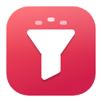
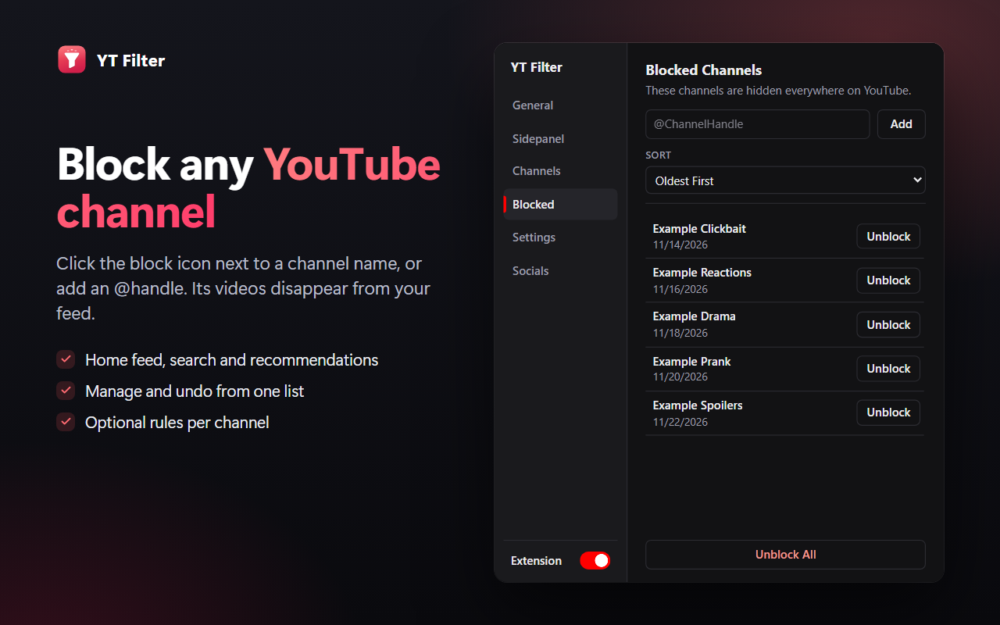
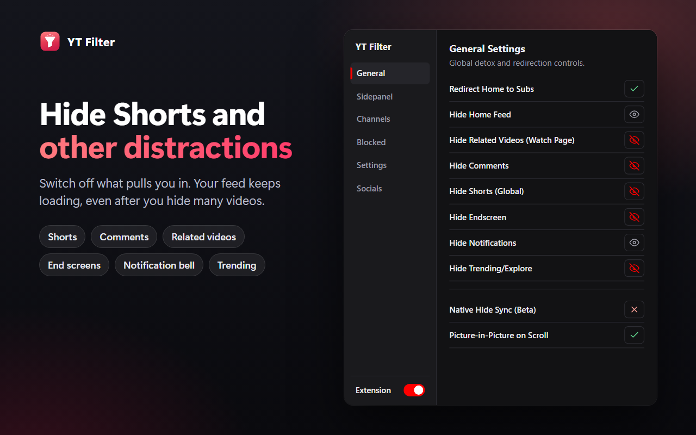
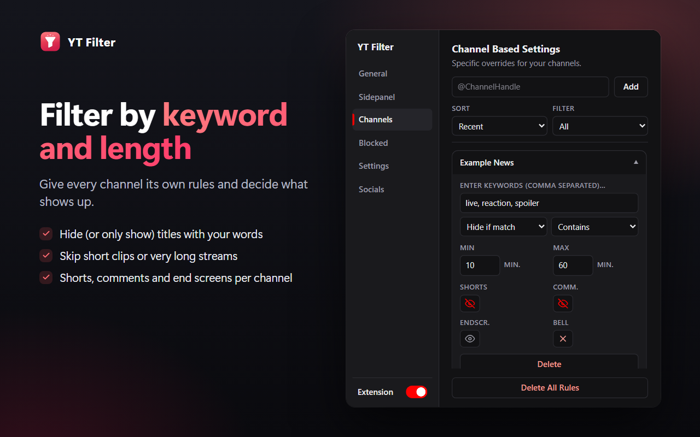
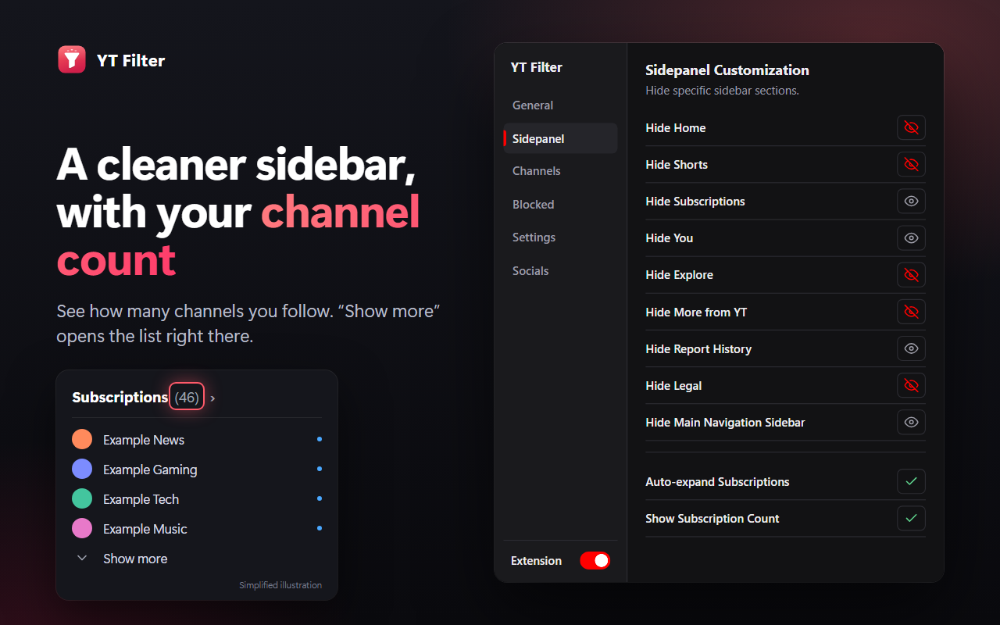
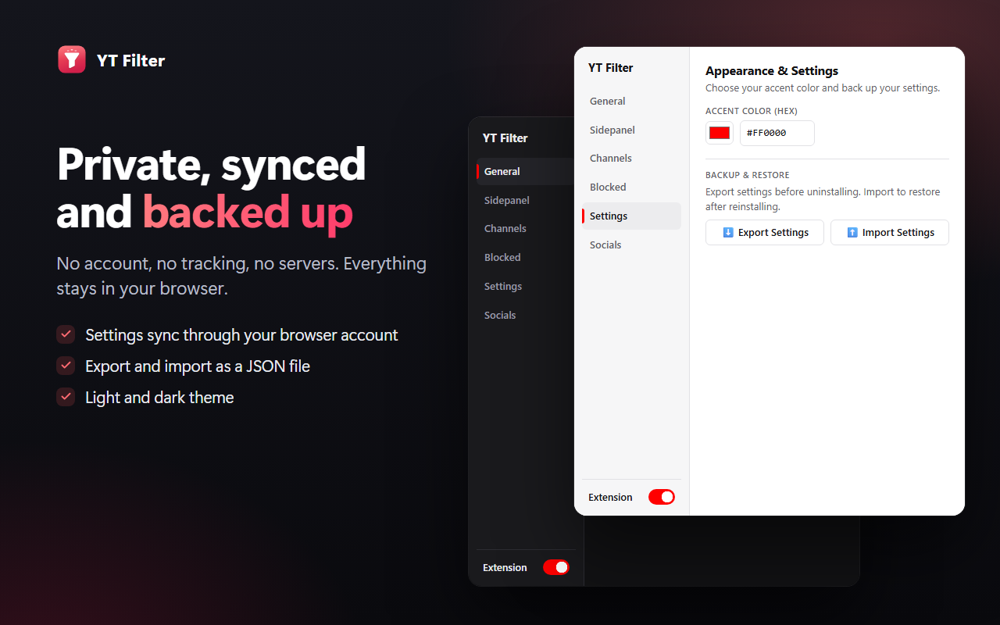

<h1 align="center">YT Filter – Channel Blocker & Hide Shorts for YouTube™</h1>

<b>Block YouTube channels, hide Shorts, and filter videos by title keyword or length. No account, no tracking, no servers.</b>

  
  
  
  

## Features

- **Block channels**: click the block icon next to a channel name, or add an `@handle`. Their videos disappear from the home feed, search results and recommendations.
- **Hide Shorts**: remove the Shorts shelf and the links to them from the feed and the sidebar.
- **Filter by keyword**: hide, or only show, videos whose title contains, starts with, ends with or exactly matches your words.
- **Filter by length**: set a minimum or maximum duration per channel.
- **Rules per channel**: keywords, duration, comments, end screens and the notification bell for one channel, while the rest follows your global setup.
- **Fewer distractions**: hide the home feed, related videos, comments, end screens, the notification bell and Trending.
- **Cleaner sidebar**: hide Home, Shorts, Explore and other sections, auto-expand your subscriptions and see how many channels you follow, e.g. `Subscriptions (46)`.
- **"Show more" stays on the page**: it opens your channel list in the sidebar instead of sending you to another page.
- **The feed keeps loading**: if YouTube stops at grey placeholders, for example after you hid many videos, the next videos are loaded.
- **Extras**: open the Subscriptions page instead of the home feed; a floating mini player while you scroll a video page.
- **Private**: settings stay in your browser and sync through your browser account. Export and import as JSON. Light and dark theme.

| | |
|---|---|
|  |  |
|  |  |

## Install

- **Chrome, Brave and other Chromium browsers:** [Chrome Web Store](https://chromewebstore.google.com/detail/mbdjpeppmemcbheedochgdejjoenijem)
- **Microsoft Edge:** [Edge Add-ons](https://microsoftedge.microsoft.com/addons/detail/youtube-channel-blocker-/kmbjgkefechegpkpfinkpodpdlkabnhd)
- **From source:** see [Development](#development).

## Getting started

1. Install the extension and open [youtube.com](https://www.youtube.com).
2. Click the YT Filter icon and switch on what you want in **General** and **Sidepanel**.
3. Block a channel with the icon next to its name, or add its `@handle` in the **Blocked** tab.
4. Open the **Channels** tab for rules with keywords and duration.

The [user guide](docs/USER_GUIDE.md) explains every option.

## Permissions and privacy

Your block list, rules and settings are stored in your browser and sync through your browser account. Nothing is sent to any server. Read the [privacy policy](PRIVACY_POLICY.md).

| Permission | Why it is needed |
|---|---|
| `storage` | save your block list, rules and settings and sync them through your browser account |
| Access to `youtube.com` only | the filters run on YouTube pages |

## Support

- Questions, bugs or ideas: [open an issue](https://github.com/exUs541/YouTube-Extension/issues).
- More about YT Filter and the other extensions: [exus541.github.io/portfolio](https://exus541.github.io/portfolio/index.html), with a [feedback form](https://exus541.github.io/portfolio/feedback.html).

## Development

The extension runs straight from this folder, there is no build step.

1. Clone the repository.
2. Open `chrome://extensions` (or `edge://extensions`) and switch on **Developer mode**.
3. Choose **Load unpacked** and select the repository folder.

| Path | Purpose |
|---|---|
| `manifest.json`, `_locales/` | extension manifest (Manifest V3) and its name and description |
| `background.js` | service worker |
| `content.js`, `styles.css` | filters and block buttons on YouTube pages |
| `popup.html`, `popup.js`, `popup.css` | settings popup |
| `icons/` | extension icons |
| `store-assets/` | store texts, screenshots, logo sources and their generator, see its [README](store-assets/README.md) |
| `docs/` | [user guide](docs/USER_GUIDE.md) |
| `.github/` | release pipeline, see [RELEASING.md](.github/RELEASING.md) |

## Disclaimer

YouTube is a trademark of Google LLC. YT Filter is an independent project and is not affiliated with, endorsed by or sponsored by Google or YouTube.
